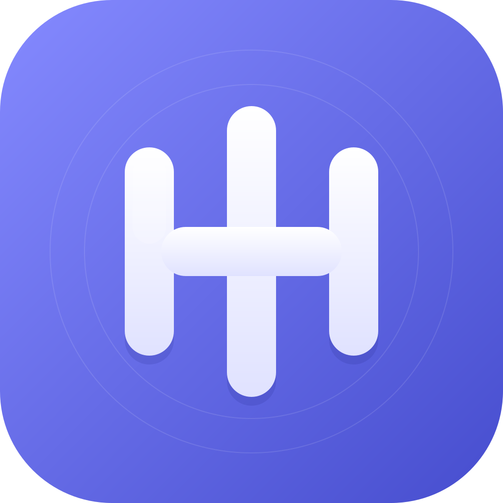

<p align="center"></p>

# Harmony

**Your music. In perfect harmony.**

An OpenRecode personal music library and native player for iPhone, iPad and Mac. Import audio you own, organize playlists, edit metadata and follow your own synchronized lyrics. The local library needs no account, subscription or server.

**Status: unreleased development preview, 0.1.0. The complete product specification is not yet implemented.** macOS compilation, automated real-audio playback and selected desktop UI flows have been verified. iOS builds and physical-device behavior require validation with full Xcode. See the [feature status matrix](docs/ROADMAP.md) and [test report](docs/reports/2026-11-06-validation.md).

## Run in a browser

```sh
node web/build.mjs
node web/server.mjs
```

Open http://127.0.0.1:4175/. Harmony remembers when you enter the library. The logo returns to the landing page. Imported audio remains in this browser. See the [web guide](docs/WEB.md).

## Run on Mac

Requires Swift 6.2+ and a compatible Apple SDK already installed. No package dependencies are downloaded.

```sh
scripts/run-mac.sh
```

For isolated QA with original generated audio:

```sh
python3 scripts/make-test-library.py
scripts/run-mac.sh --qa-library "$PWD/.build/QA-Library"
```

Import files from `.build/Fixtures` using the app's Import button. QA audio is synthetic original test content, never commercial recordings. Normal library storage is in Application Support/Harmony; QA has its own root.

## Build for iPhone and iPad

Open `Harmony.xcodeproj` in full Xcode, select the Harmony scheme and an iPhone/iPad destination, select your signing team, and run. No MusicKit entitlement or provider account is needed for local files. Exact CLI commands and signing notes: [iOS](docs/IOS.md).

```sh
scripts/build-ios.sh simulator
scripts/build-ios.sh unsigned-device
```

Unsigned device IPAs require signing through an appropriate external workflow before ordinary-device installation. Simulator apps are packaged separately. These commands have been prepared but not run in the initial environment because full Xcode was unavailable.

## Current capabilities

- Managed audio import with runtime AVFoundation validation, SHA-256 duplicate detection and SQLite persistence.
- Local playback, seek, shuffle, repeat, queue editing and paused restoration.
- iOS background-audio configuration and system-media integrations (device validation pending).
- Songs, album/artist/genre groupings, favorites, local search and playlists.
- M3U/M3U8, PLS, CSV, XSPF, JSON and pasted-list playlist import with explicit matching review.
- Database metadata editing, manual artwork selection and explicit MusicBrainz search.
- Plain text and line-synchronized LRC, timing correction, lyrics editing and export.
- Authorized direct HTTPS audio-file download with progress/cancellation and import.
- Metadata-only backup/restore, individual audio export, developer Ideas and changelog.

Ogg/Opus decoding, safe embedded-tag writing, fingerprinting, streaming-provider adapters, full audio backup, advanced audio processing and live Fetch interoperability remain incomplete. No mock provider is presented as connected.

## Test and contribute

```sh
scripts/check.sh
```

Start with [documentation](docs/INDEX.md), [architecture](docs/ARCHITECTURE.md), [contributing](CONTRIBUTING.md) and [security](SECURITY.md). All original source is [AGPL-3.0-only](LICENSE). Recordings, artwork and lyrics retain their applicable rights. No public repository, service or release has been published.
